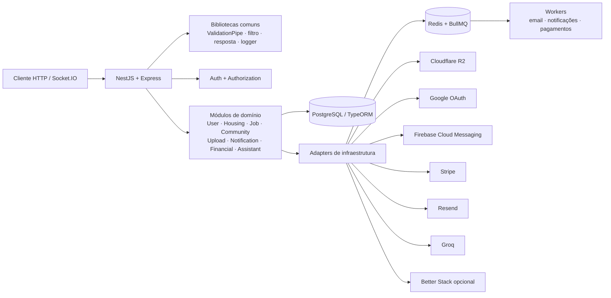

# NestJS Backend Foundation

Fundação backend modular com NestJS e TypeScript, criada para demonstrar decisões de arquitetura, segurança, integrações externas, processamento assíncrono, observabilidade, testes e entrega contínua.


> Projeto de portefólio desenvolvido por **Lucas Santiago de Oliveira Martins**, Backend Engineer. É uma fundação técnica genérica para demonstração e evolução; não documenta um produto comercial.

## Índice

- [Visão geral](#visão-geral)
- [Stack e infraestrutura](#stack-e-infraestrutura)
- [Capacidades](#capacidades)
- [Arquitetura](#arquitetura)
- [Estrutura do repositório](#estrutura-do-repositório)
- [Módulos](#módulos)
- [Configuração](#configuração)
- [Pré-requisitos](#pré-requisitos)
- [Executar localmente](#executar-localmente)
- [API e exemplos](#api-e-exemplos)
- [Testes e qualidade](#testes-e-qualidade)
- [Docker e deployment](#docker-e-deployment)
- [Decisões de engenharia](#decisões-de-engenharia)
- [Licença](#licença)
- [Autor](#autor)

## Visão geral

O **NestJS Backend Foundation** é uma API de demonstração organizada como monólito modular. O código explora autenticação, autorização por papéis, persistência relacional, tempo real, tarefas em fila, uploads, pagamentos, notificações, email, integração com IA, logging e automação de deployment.

O repositório é útil para estudar como organizar capacidades distintas em módulos NestJS, centralizar políticas transversais, encapsular dependências externas e manter testes junto dos domínios. A aplicação continua sendo um único serviço implantável; não é uma arquitetura de microservices.

## Stack e infraestrutura

| Categoria | Tecnologia | Utilização confirmada |
|---|---|---|
| Runtime e linguagem | Node.js 24, TypeScript 5 | API, workers e código compilado para `dist/`. |
| Framework HTTP | NestJS 10, Express | Módulos, controllers, providers, validação e ciclo de vida da aplicação. |
| Persistência | PostgreSQL 15, TypeORM 0.3 | Entidades relacionais carregadas pelos módulos. |
| Filas e tarefas | Redis 7, BullMQ, `@nestjs/bullmq`, Bull Board | Filas de email, notificações e processamento de pagamentos; retries e backoff exponencial. |
| Autenticação | JWT, Passport, Google OAuth 2.0, bcryptjs, cookies | Sessões/token, login social, hash de palavra-passe e cookies de autenticação. |
| Autorização | Guards globais e decorators de papéis | Proteção por autenticação e papéis definidos na biblioteca interna `authorization`. |
| Tempo real e push | Socket.IO, Nest WebSockets, Firebase Admin | Gateways para comunidade/notificações e envio de push via Firebase Cloud Messaging. |
| Armazenamento | Cloudflare R2 via AWS SDK S3 | URLs pré-assinadas e operações compatíveis com S3. |
| Pagamentos | Stripe SDK | Payment Intents e processamento de webhooks; existe também provider mock. |
| Email | Resend API | Envio assíncrono de templates pela fila BullMQ. |
| IA | Groq SDK | Serviço de chat/assistente e interpretação estruturada. |
| Logging | Pino, `nestjs-pino`, integração Better Stack opcional | Logs estruturados; em produção tenta enviar eventos ao endpoint configurado. |
| Configuração e validação | `@nestjs/config`, `class-validator`, `class-transformer` | Configuração por ambiente e transformação/validação de DTOs. |
| Testes | Jest, ts-jest, Supertest, `@nestjs/testing` | Unitários e e2e. |
| Qualidade | ESLint, Prettier | Lint e formatação. |
| Containers | Docker multi-stage, Docker Compose | Imagem de produção e serviços PostgreSQL/Redis. |
| CI/CD | GitHub Actions, SSH, VPS | Testes, build e atualização remota da aplicação na branch `main` (`.github/workflows/deploy.yml`). |

## Capacidades

- **Identidade e acesso:** registo, login, logout, recuperação e alteração de palavra-passe, Google OAuth, JWT e controlo de acesso por papéis. O guard JWT é global e rotas públicas são marcadas explicitamente.
- **Perfis e domínios:** utilizadores e perfis; anúncios e pedidos de alojamento; empresas e anúncios de emprego; comunidades, membros e mensagens.
- **Persistência:** entidades TypeORM para os domínios acima, pagamentos, planos, subscrições, notificações, tokens push e uploads.
- **Uploads:** geração de URLs pré-assinadas para R2, validação de uploads e serviço de limpeza. O cliente transfere o conteúdo diretamente para o armazenamento usando a URL.
- **Tempo real e notificações:** gateways Socket.IO, notificações persistidas, tokens push e processador de notificações.
- **Trabalho assíncrono:** filas BullMQ para email, notificações e pagamentos, com até três tentativas e backoff exponencial de cinco segundos configurados nas filas.
- **Email:** templates HTML para autenticação, alojamento e pagamentos, entregues pelo Resend através de worker.
- **Pagamentos:** planos e subscrições, criação de tentativas de pagamento, Stripe Payment Intents com chave de idempotência e endpoint de webhook. O modo mock é disponível para desenvolvimento/testes.
- **Assistente:** endpoint de aplicação que combina a camada de inteligência com dados de alojamento e emprego; a integração de modelo usa Groq.
- **Validação e erros:** `ValidationPipe` global com `whitelist` e `transform`, filtro global de exceções e interceptor comum de resposta.
- **Observabilidade e operação:** logs estruturados Pino, integração Better Stack configurável e painel Bull Board em `/admin/queues`.
- **Entrega:** testes unitários/e2e, build NestJS, imagem Docker multi-stage e workflow de CI/deploy para VPS.

Algumas capacidades exigem credenciais externas válidas. A presença de um provider ou configuração não garante que a conta externa, domínio, webhook ou ambiente de produção já esteja provisionado.

## Arquitetura

O projeto segue um **Modular Monolith**: uma aplicação NestJS e uma unidade de deployment, divididas em módulos de domínio e módulos de infraestrutura. Os módulos registados em `AppModule` declaram controllers, providers e entidades, e podem exportar serviços para consumidores internos. Os aliases TypeScript `@modules/*`, `@infra/*` e `@backend-foundation/*` tornam explícitas as fronteiras do código.

Controllers tratam o protocolo HTTP/WebSocket e delegam operações aos services; DTOs descrevem e validam entradas/saídas; entities representam persistência; providers em `infrastructure` encapsulam SDKs e serviços externos. As bibliotecas `common` e `authorization` concentram políticas e mecanismos transversais reutilizados. Nem todo acesso de infraestrutura está abstraído: alguns serviços leem `process.env` diretamente e a persistência usa TypeORM dentro dos módulos de domínio.



Este desenho facilita testes por domínio e mudanças internas sem operação distribuída entre serviços. A extração de um módulo exigiria definir contratos de API/eventos, propriedade dos dados e migrações, substituir chamadas diretas entre módulos por integração remota e provisionar deployment, segurança e observabilidade independentes.

## Estrutura do repositório

```text
.
├── .github/workflows/deploy.yml # CI e deployment SSH para VPS
├── libs/
│   ├── authorization/       # guards, decorators e configuração JWT
│   └── common/              # respostas, erros, logging e utilitários comuns
├── scripts/                 # runner de testes por ficheiro
├── src/
│   ├── config/              # configurações registadas por integração
│   ├── infrastructure/      # adapters, filas, SDKs e templates
│   ├── modules/             # aplicação e módulos de domínio
│   ├── main.ts              # bootstrap HTTP com raw body para webhooks
│   └── modules/app.module.ts # composição da aplicação
├── test/                    # mocks usados na configuração Jest
├── Dockerfile
├── docker-compose.yml       # stack de produção
├── docker-compose.dev.yml   # PostgreSQL e Redis locais
├── jest.config.js
└── jest.e2e.config.js
```

## Módulos

| Módulo | Responsabilidade e relações principais |
|---|---|
| `AuthModule` | Login, logout, OAuth Google, cookies e recuperação de palavra-passe; usa `UserModule`, `PasswordRecoveryCode` e `AuthorizationModule`. |
| `AuthorizationModule` (biblioteca) | Inicializa JWT e instala guards globais de autenticação e papéis; disponibiliza decorators e utilitários de autorização. |
| `UserModule` | Utilizadores e perfis, endpoints de conta e perfil; integra uploads e alojamento. |
| `HousingModule` | Anúncios, quartos e pedidos de reserva, incluindo operações de publisher; expõe serviços usados pelo assistente. |
| `JobModule` | Empresas, anúncios e requisitos de emprego, com endpoints de consulta e gestão de publishers; expõe dados ao assistente. |
| `CommunityModule` | Comunidades, adesão, mensagens, administração, seed e gateway Socket.IO. |
| `UploadModule` | Ciclo de vida e validação de uploads, URLs pré-assinadas e limpeza; usa o adapter Cloudflare R2. |
| `NotificationModule` | Notificações, tokens push, gateway e processador; usa Firebase através do serviço de push. |
| `FinancialModule` | Planos, subscrições, pagamentos, processamento e webhook Stripe; integra notificações e provider de pagamento. |
| `AssistantModule` | Orquestra pedidos do assistente e consulta `IntelligenceModule`, alojamento e emprego. |
| `QueueModule` | Configura Redis/BullMQ, filas de email/notificação/pagamento e painel Bull Board em `/admin/queues`. |
| `MailModule` | Renderiza templates e processa envios Resend como worker da fila de email. |
| `FirebaseModule` | Inicializa e disponibiliza Firebase Admin/Cloud Messaging globalmente. |
| `IntelligenceModule` | Define interfaces, prompt, schema de interpretação e integração Groq consumida pelo assistente. |
| `StripeModule` | Encapsula cliente Stripe e provider de pagamento usado por `FinancialModule`. |
| `CloudflareR2Module` | Disponibiliza cliente S3 compatível consumido por `UploadModule`. |
| `AppLoggerModule` / `common` | Logger Pino e mecanismos reutilizáveis de resposta e tratamento de exceções. |

## Configuração

`ConfigModule` é global e carrega `.env` quando `NODE_ENV=production`; nos outros casos procura `.env.dev`. O repositório fornece `.env.example`, que deve ser copiado para o nome efetivamente carregado. Os ficheiros `.env` são locais, estão ignorados pelo Git e devem conter os segredos reais apenas no ambiente de execução.

As configurações Google, R2, Groq e Resend são registadas em `src/config/` e verificam a presença das respetivas variáveis ao inicializar. Como são carregadas pela aplicação, essas credenciais são atualmente necessárias para o bootstrap padrão, mesmo quando se pretende usar apenas outro domínio. JWT também falha no arranque sem `JWT_SECRET`; Firebase Admin é inicializado pelo módulo global, então requer service account válida. Não existe um esquema central de validação de todas as variáveis. Stripe permite provider mock por omissão na configuração, embora `.env.example` declare `PAYMENT_PROVIDER=stripe`.

| Variável | Finalidade | Obrigatória? | Onde obter ou como configurar |
|---|---|---|---|
| `PORT`, `NODE_ENV` | Porta HTTP e seleção do ficheiro env (`.env` em produção; `.env.dev` caso contrário). | `PORT` opcional (3000); `NODE_ENV` recomendado. | Definir no ambiente de execução. |
| `DB_HOST`, `DB_PORT`, `DB_USER`, `DB_PASS`, `DB_NAME` | Ligação PostgreSQL via TypeORM. | Sim para persistência; sem defaults no código. | PostgreSQL local via Compose ou instância gerida. Em Compose local, usar `localhost:5432`; dentro da rede Compose, hostname `postgres`. |
| `JWT_SECRET`, `JWT_EXPIRES_IN` | Assinatura JWT e expiração (default `1d`). | Segredo obrigatório; expiração opcional. | Gerar segredo aleatório forte, por exemplo `openssl rand -base64 48`; nunca reutilizar o placeholder. |
| `GOOGLE_CLIENT_ID`, `GOOGLE_CLIENT_SECRET` | Credenciais OAuth Google. | Atualmente sim no bootstrap. | [Google Cloud Console](https://console.cloud.google.com/apis/credentials); configurar callback autorizado. |
| `GOOGLE_CALLBACK_URL`, `GOOGLE_FRONTEND_REDIRECT_URL` | Callback OAuth backend e redirecionamento após autenticação. | Atualmente sim no bootstrap. | URLs locais/de produção; callback local indicado no exemplo é `/auth/google/callback`. |
| `R2_ACCESS_KEY`, `R2_SECRET_KEY`, `R2_ENDPOINT`, `R2_BUCKET`, `R2_PUBLIC_URL` | Credenciais, endpoint S3, bucket e base pública para uploads. | Atualmente sim no bootstrap. | Criar bucket e token API com permissões mínimas no [Cloudflare Dashboard](https://dash.cloudflare.com/). URL pública deve apontar para o domínio configurado do bucket. |
| `FIREBASE_PROJECT_ID`, `FIREBASE_CLIENT_EMAIL`, `FIREBASE_PRIVATE_KEY` | Inicialização Firebase Admin e push. | Necessárias para Firebase; módulo global inicializa sempre. | Criar service account no [Firebase Console](https://console.firebase.google.com/); manter a chave privada protegida. Para env, codificar quebras de linha como `\n`. |
| `REDIS_HOST`, `REDIS_PORT` | Ligação BullMQ (sem autenticação/TLS configuradas no código). | Sim para filas; exemplo usa `localhost:6379`. | Redis local via Compose ou endpoint de serviço gerido; ajustar hostname conforme execução. |
| `GROQ_API_KEY`, `GROQ_MODEL` | Acesso ao modelo usado pela integração de inteligência. | Atualmente sim no bootstrap. | Criar chave e escolher modelo disponível em [Groq Console](https://console.groq.com/). |
| `BETTER_STACK_INGEST_URL`, `BETTER_STACK_TOKEN` | Envio de logs estruturados em produção. | Opcionais; sem ambos não há envio externo. | Criar source de logs no [Better Stack](https://betterstack.com/) e configurar endpoint/token de ingestão. |
| `RESEND_API_KEY`, `RESEND_FROM_EMAIL` | Credenciais e remetente de email assíncrono. | Atualmente sim no bootstrap. | Criar API key e verificar domínio/remetente no [Resend](https://resend.com/). |
| `PAYMENT_PROVIDER`, `PAYMENT_MOCK_OUTCOMES` | Seleciona Stripe/mock; outcomes de simulação (default `success,failure`). | Opcional no código; exemplo define Stripe. | Use `mock` localmente ou `stripe` com credenciais. Outcomes usados para testes/desenvolvimento. |
| `STRIPE_SECRET_KEY`, `STRIPE_PUBLISHABLE_KEY`, `STRIPE_WEBHOOK_SECRET`, `STRIPE_API_VERSION` | Cliente Stripe, chave pública entregue na resposta de pagamento, verificação de webhook e versão API. | Condicional ao fluxo Stripe; versão tem default no código. | Obter chaves de teste/produção e signing secret em [Stripe Developers](https://dashboard.stripe.com/apikeys); configurar webhook para `/webhooks/stripe`. |

> **Nota operacional:** `.env.example` não é automaticamente carregado. Para desenvolvimento, crie `.env.dev`; para o container de produção, forneça `.env` no host, que é referenciado pelo Compose. Não commite esses ficheiros. `docker-compose.dev.yml` usa interpolação de variáveis para PostgreSQL e o script `dev:infra` passa `--env-file .env.dev`.

## Pré-requisitos

- Node.js 24, versão usada no Dockerfile e workflow CI; npm incluído com Node.js.
- Docker Engine e Docker Compose plugin para subir PostgreSQL/Redis localmente.
- Contas/credenciais externas apenas para as integrações que pretende executar. O bootstrap padrão atual exige credenciais Google, R2, Groq, Resend e Firebase válidas, além de PostgreSQL, Redis e JWT.

## Executar localmente

1. Instale dependências e prepare a configuração:

   ```bash
   npm ci
   cp .env.example .env.dev
   ```

2. Edite `.env.dev` com as credenciais e configurações necessárias. Para desenvolvimento sem Stripe, defina `PAYMENT_PROVIDER=mock`.

3. Inicie PostgreSQL e Redis:

   ```bash
   npm run dev:infra
   ```

4. Inicie a API em modo watch:

   ```bash
   npm run start:dev
   ```

A API escuta em `http://localhost:3000` por omissão. A aplicação não declara prefixo global de rota nem publica Swagger/OpenAPI no código analisado.

## API e exemplos

Rotas disponíveis incluem:

| Domínio | Prefixos confirmados |
|---|---|
| Autenticação | `/auth` |
| Conta/perfil | `/users`, `/users/profile` |
| Alojamento | `/housing-listings`, `/housing-booking-requests`, `/publishers/housing-listings`, `/publishers/housing-booking-requests` |
| Emprego | `/job-listings`, `/job-listings/publishers`, `/job-listings/publishers/companies` |
| Comunidades | `/communities`, `/communities/:communityId/messages` |
| Uploads | `/uploads` |
| Notificações | `/notifications` |
| Assistente | `/assistant` |
| Financeiro | `/financial/plans`, `/subscriptions`, `/webhooks/stripe` |
| Filas | `/admin/queues` |

A autenticação JWT e autorização por papel aplicam-se globalmente, com exceção de rotas marcadas como públicas. Os DTOs e decorators dos controllers definem os campos aceites e as permissões de cada endpoint.

Exemplos de caminhos confirmados (os corpos devem seguir os DTOs correspondentes):

```http
POST /auth/login
POST /auth/forgot-password
GET  /housing-listings
POST /uploads/presigned
POST /assistant/ask
POST /webhooks/stripe
```

Os handlers aplicam um interceptor de resposta comum, por isso a forma exata de cada payload depende do DTO e do decorator de mensagem de sucesso. Não assuma um envelope ou exemplo de JSON sem consultar o endpoint concreto.

## Testes e qualidade

O Jest separa specs unitárias (`jest.config.js`) de testes e2e localizados em `tests/e2e` (`jest.e2e.config.js`). Os testes e2e criam aplicações Nest de teste; confirme variáveis/serviços externos requeridos antes de executá-los.

```bash
npm test                 # suíte Jest padrão (unitária)
npm run test:unit
npm run test:e2e
npm run test:watch
npm run test:cov
npm run test:file -- src/modules/user/tests/unit/user.service.spec.ts
npm run build
npm run lint             # ESLint com --fix
npm run format           # Prettier escreve os ficheiros abrangidos
```

`test:file` deteta caminhos `tests/e2e` ou sufixo `.e2e-spec.ts` e escolhe a configuração e2e. Os comandos `lint` e `format` alteram ficheiros. O workflow CI executa testes unitários, e2e e build; não executa lint.

## Docker e deployment

`docker-compose.dev.yml` sobe apenas PostgreSQL 15 e Redis 7, expondo portas `5432` e `6379` para desenvolvimento local. O Dockerfile é multi-stage: instala dependências, compila e cria uma imagem final Node 24 Alpine com dependências de produção e `dist/`.

`docker-compose.yml` define PostgreSQL, Redis e API na mesma rede Docker, com volumes persistentes para dados e API publicada em `127.0.0.1:3000`. A aplicação resolve os serviços pelos nomes `postgres` e `redis` no ambiente containerizado, conforme o `.env` utilizado.

O workflow `.github/workflows/deploy.yml` dispara em push para `main` ou manualmente. Primeiro executa `npm ci`, testes unitários/e2e e build. Após sucesso, liga por SSH à VPS, atualiza `/opt/apps/nestjs-backend-foundation-api` para `origin/main`, valida `docker compose config` e executa `docker compose up -d --build --remove-orphans`. Secrets do GitHub esperados pelo workflow: `VPS_SSH_KEY`, `VPS_KNOWN_HOSTS`, `VPS_HOST` e `VPS_USER`. O host precisa ter checkout, `.env` e Docker Compose configurados.

## Decisões de engenharia

- Configurei TypeORM com `synchronize: true` para manter o schema alinhado às entidades durante esta fase de desenvolvimento. Para gerir evolução de dados em produção, o próximo passo é versionar alterações do schema e desativar a sincronização automática.
- Centralizei configuração com `@nestjs/config` e registei configurações específicas para Google, R2, Groq, Resend e Stripe. JWT, filas e Firebase são inicializados nos respetivos módulos; as variáveis locais ficam fora do Git.
- Mantive filas BullMQ e o painel Bull Board no mesmo serviço para simplificar operação e inspeção do processamento assíncrono. Em deployment público, o acesso ao painel deve ficar restrito à equipa de operação.
- O código é disponibilizado sob a licença MIT. Consulte os termos completos no ficheiro [`LICENSE`](LICENSE).

## Licença

Este projeto está licenciado sob a [MIT License](LICENSE). Copyright © 2026 Lucas Santiago Martins.

## Autor

**Lucas Santiago de Oliveira Martins** — Backend Engineer.
